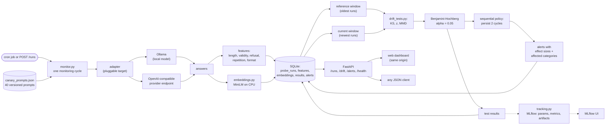

# LLM Drift Monitor

A monitoring tool that watches whether an LLM's answers quietly change over time, and
tells you when they do. The research question behind it: **when is unsupervised
behavioral drift a reliable proxy for quality regression (measured here as the
non-empty response rate, kept deliberately conservative, never a correctness
claim), when is it not, and how much does combining distributional
and behavioral signals buy?** The experiments section answers this with numbers
rather than intuition.

Live demo: [llm-drift-monitor-api.onrender.com](https://llm-drift-monitor-api.onrender.com)
(dashboard at `/`). The hosted demo sends its canary prompts to a live external LLM
(Google Gemini 3.1 Flash-Lite) through the pipeline this repository ships, and the
reference baseline was generated by Gemini itself with identical prompts, decoding
settings and embeddings, so the shift verdicts compare Gemini against Gemini. The
API key lives only in the Render secret store; a visitor's checks are rate limited
(one per visitor interval, plus a shared daily cycle budget) to respect the free
tier. When the provider key is missing the service states "provider
not_configured" explicitly and keeps serving stored history; it never falls back
to a synthetic adapter while presenting it as the provider.

## The problem

Suppose your product answers come from an LLM. Nothing about that LLM is pinned down.
Providers update models, add safety layers, change default settings, or quietly route
you somewhere else, and each of those can change what your users see. The failure is
invisible: no exception fires, the status code stays 200, answers just get longer,
start refusing more often, or drift in topic. You find out from a complaint, possibly
weeks later.

Checking by hand doesn't work either. One answer tells you almost nothing, because
models vary naturally from answer to answer. And reading dozens of answers every
morning doesn't scale.

## System design

Everything is one pipeline: fixed prompts go out, answers come back, statistics decide
whether the answers changed, and every step is recorded.

Notes on the parts that are easy to get wrong:

- Windows compare like with like: only runs from the same prompt set version and the
  same prompt ids as the current cycle are eligible, so reference and current always
  contain responses to the same prompts, and the windows are disjoint by construction.
  A changed prompt mix cannot masquerade as model drift.
- The adapter is pluggable. The same pipeline runs against a local model over Ollama,
  against any hosted OpenAI-compatible endpoint (verified against Groq,
  `openai/gpt-oss-20b`), or against Gemini through its native `generateContent`
  endpoint (verified against `gemini-3.1-flash-lite`), so the monitor follows whatever
  the product actually calls in production. Keys come from the environment only and a
  provider failure is reported, never silently replaced by the fake adapter.

## Operational design

The service runs in one small container, so the reliability choices are sized to that
rather than borrowed from bigger deployments:

- **Read cache.** Dashboard panels poll `/stats`, `/drift/latest`, `/drift/results`, and
  `/alerts` through a 5 second TTL cache, so repeat polls and concurrent visitors collapse
  into one set of queries per window. A finished cycle invalidates it, so panels never lag
  behind a result.
- **Single flight run queue.** Cycles write to SQLite and share the embedding model, so
  they are serialized through a one worker queue. `POST /runs` accepts an `Idempotency-Key`
  header and replays the original run id for duplicate submissions; a minimum interval
  between submissions acts as a rate limit, returning `429` with `Retry-After`.
- **Circuit breaker.** The target model adapter opens after three consecutive failed calls
  and fails fast for a cooldown window, instead of paying full retries on every probe while
  the endpoint is down. Retries themselves use exponential backoff with jitter on 429, 5xx,
  timeouts, and network errors.
- **Storage.** SQLite runs in WAL mode, so dashboard reads proceed while a cycle writes,
  and every filter and ordering column is indexed.
- **Observability.** `GET /metrics` exposes counters (cycles, failures, queue depth, cache
  hit rate, rejections, peak memory, embedding model residency) in Prometheus text format.
  Every request is logged as one structured JSON line with a correlation id (`X-Request-ID`
  on both request and response), and run cycles log duration and outcome the same way.
- **Keeping the demo awake.** The free tier pauses the service after 15 minutes without
  traffic, and the first request to a paused instance waits out the spin up. A scheduled
  GitHub Action pings the health endpoint every ten minutes, so the demo usually answers
  immediately; without that workflow a fresh visit can take a minute or two.- **MLflow without the memory cost.** Each cycle logs its params, metrics, and the full
  drift report to MLflow from a short lived subprocess: the serving process never imports
  mlflow, so a memory capped deployment stays safe while every run still lands in the
  tracking store, pinned to the exact git hash and config.

Deliberately not used: read replicas, data sharding, and a CDN. There is one SQLite file
per deployment, queried through indexed paths; sharding or replicas would add moving parts
without a load problem to solve. Static assets are two files served from the same origin,
so a CDN would only add a third place to cache. If the demo outgrows the free tier, the
seams that matter are already in place: the tracking URI is configurable (a hosted MLflow
backend drops in), the queue is the single place runs are admitted, and reads already go
through one cache layer.

## How MLflow is used

`tracking.py` wraps every daily run and every experiment sweep in an MLflow run, so
each check is reproducible and comparable:

| Captured | Examples |
|---|---|
| Params | target model, prompt set version, embedding model, alpha, window sizes, kernel bandwidth, git hash, seed |
| Metrics | KS / z / MMD statistics, raw p values, BH-adjusted p values, number of flagged tests, token counts |
| Artifacts | the full drift report as JSON |

That makes two things possible. First, provenance: every alert on the dashboard
corresponds to an MLflow run pinned to an exact commit and config. Second, iteration:
detector configurations (embedding model, bandwidth heuristic, window sizes) are logged
as separate runs, so the MLflow UI can compare them directly instead of trusting a
notebook.

Daily runs land in the `llm-drift-daily` experiment; experiment sweeps land in
`llm-drift-experiments`. The backend is a local SQLite file, so the whole setup runs
with no server and no credentials.

## How this project handles it

The monitor runs a fixed, category-balanced panel of 10 prompts (two per category,
round robin from the 40 prompt suite) against the target model on a schedule and
stores every answer in SQLite. The panel stays fixed across cycles so windows stay
matched; the other 30 prompts are currently not exercised, which is the coverage
trade documented in the limitations below. Each check then compares a batch of recent
answers with a saved baseline, using three small statistical tests:

1. **Answer length**: a KS test asks whether recent answers are noticeably longer or
   shorter than the baseline ones.
2. **Useful answers**: a two-sample test on how often answers come back empty.
   A jump here usually means the model started refusing or breaking. Fisher's exact
   test is used when the expected cell counts are too small for the normal
   approximation, and the z-test otherwise.
3. **What answers mean**: answers are turned into text embeddings, and an MMD test
   (kernel based, permutation p value) asks whether the overall meaning mix changed,
   which catches topic or tone drift that length and counts miss. Duplicate
   embeddings are collapsed before the test (ten copies of one answer are one
   observation), and when the panel is matched the results also carry a paired
   prompt level permutation that exchanges whole prompts' answer sets, so repeated
   prompts cannot pass for independent evidence.

Alongside the embeddings, every answer gets rule based behavioral features: refusal
markers, repetition ratio, code block presence, and token count. These stay separate
from the semantic tests on purpose: an answer can change in meaning without getting
worse, and a refusal detector that is a handful of regexes should be described as
exactly that.

Three tests at once should not make three chances to cry wolf, so raw p values go
through Benjamini-Hochberg correction at alpha = 0.05 before anything is flagged.
And because the same test runs every cycle, a flag has to persist for two consecutive
cycles before an alert fires. To be precise about what that is: the correction handles
comparisons across tests within a cycle, and the persistence rule is an operational
alert filter that suppresses isolated borderline flags. It is not a formal sequential
error control procedure; there is also an optional, off-by-default alpha-spending
schedule (Holm within the cycle, a conservative across-cycle budget) for deployments
that want that stricter gate. Both are configuration, not folklore, and the delay
experiment reports the deployed rule's measured false-alarm and delay trade-off.

When an alert does fire, it carries its evidence: which tests fired, the MMD statistic,
the centroid distance baseline, the percentage length shift, and which prompt categories
are affected. Category-wise MMD runs on wider windows (five cycles worth, still matched
to the same prompts and still disjoint from the baseline), with its own multiple testing
correction, so an alert comes with a best-effort pointer at where things changed. At
production sample sizes that pointer is often inconclusive (see the evaluation below);
it is evidence for a person, not a verdict. Nothing is auto-panic: a flag means "look
at the answers", and a person decides.

## Does it actually work

Evaluated on synthetic data where the truth is known, using `experiments/`. Every
number below is the value in the corresponding committed CSV in `results/`, every
experiment runs at production parity (50 reference runs, 10 current per cycle, 500
MMD permutations, matching `config/config.yaml`), and every script takes a `--seed`,
so they can be regenerated. These are simulation and benchmark measurements, not
long-run production guarantees.

Four headline metrics, each answering one operational question:

| Metric | Value | Answers | Source |
| --- | --- | --- | --- |
| Detection delay | 0.97 days mean, 1.0 median | How fast does the monitor catch drift? | `delay_detection_delay.csv` |
| False alarm rate | 0.18 per 100 quiet days | How noisy is the monitor? | `delay_false_alarms.csv` |
| Detection rate | 100% | How often is drift caught? | `delay_detection_delay.csv` |
| p95 monitoring overhead | 0.388 s per cycle | What does monitoring cost besides inference? | `overhead_latency.csv` |

Delay, false alarms and detection rate are for the deployed persistence rule (a flag
must hold two consecutive cycles) in a 90 day simulation with the drift injected on
day 45 at 1.2 standard deviations, against an unfiltered single-cycle flag at 3.09
false alarms per 100 quiet days: persistence trades about one day of delay for a
seventeen-fold quieter baseline. The 100% detection rate applies to that particular
simulated shift, not to every possible drift; smaller shifts have the lower powers
reported in `METRICS.md`. Overhead is the per-cycle cost of embedding extraction,
features, all statistical tests and storage with the in-process demo adapter,
measured over 12 cycles; against a real provider, per-call latency is measured
separately each cycle and is provider-dominated. Alert precision (0.998 in the same
simulation, counted over alert-days) is a supporting simulation result documented in
`METRICS.md`, not a headline claim.

The supporting diagnostics behind those numbers, per-test calibration (raw
false-positive rates at or below the nominal 5%, 1.9% any-test after
Benjamini-Hochberg across 1,000 null simulations), power curves, bandwidth
ablation, detector baselines and the honest limits of category localization at
production sample size, are all in `METRICS.md`.

## The research question: is drift a reliable proxy for quality regression?

This is the central study (`reliability_results.csv`, exactly 100 stratified trials
per condition, full methodology and tables in `METRICS.md`). The monitor produces two
independent signal families: distributional (KS on lengths, MMD on embeddings) and
behavioral (the validity test, backed by refusal and repetition features). A 2x2 of
distribution shift and invalid-response regression measures how they relate. The
scope is deliberate: regression here means the invalid-response rate rising from 5%
to 30%, not general answer correctness, which this project does not measure.

Three findings. First, the families are nearly disjoint: a silent invalid-response
regression, the kind the MMD windows structurally cannot see, is caught 27% of the
time by the behavioral test at production panel size and 3% by the distributional
family; a benign distribution shift is caught 100% versus 0%. The 27% is itself
informative: with 10 probes per cycle, a validity drop of that size is genuinely hard
to catch in one cycle. Second, on an equal mixture, a drift flag alone is a weak
regression proxy: P(regression | distributional flag) is 0.50, a coin flip, while the
behavioral flag sits at 0.98. Third, the combination buys recall, not precision: the
deployed pooled pipeline detects 65% of regressions against 25% behavioral alone and
51% distributional alone, and proxy precision degrades as benign shifts become common
(the distributional family falls from 0.81 to 0.34 as the benign base rate rises from
0 to 0.4, while the behavioral signal stays near 0.95). In short: distributional
drift finds the changes, behavioral features tell you whether they hurt, and neither
substitutes for the other.

## Try it

- Live demo: open the URL above and press "Run a check". One cycle stores 40
  answers through the hosted model and the panels refresh; the demo page then
  walks the full loop illustrated below: verdict, detector cards with effect
  sizes, the per prompt reference vs current comparison (with the safety
  boundary prompts shown as public labels only), category evidence with the
  counts behind every skip decision, alert history, and a separate System
  evaluation tab for the simulation numbers plus the recorded Groq versus
  Gemini comparison (a committed artifact derived from the stored experiment
  outputs, presented as cross-provider adapter evidence, never a drift
  verdict). The first 160 stored responses make an evaluation cycle: the
  committed Gemini baseline plus one current cycle. Checks run one prompt
  panel cycle at a time; with the 13 second call spacing that respects the
  free tier quota, a cycle takes several minutes.
- Local, no keys needed: `python -m scripts.generate_seed_db` (synthetic
  adapter, uses the 10 prompt panel and the seeded shift history), then
  `uvicorn api:app --port 8000` and open `http://localhost:8000`.
- With your own local model (Ollama): point `config/config.yaml` at `target.type: local`
  and run `python -m main --run` as a daily cron job.
- Against real hosted providers: set `GROQ_API_KEY` and `GEMINI_API_KEY` and run
  `DRIFT_MONITOR_TRACKING=0 python -m experiments.real_providers`. It fills the
  reference window from Groq, switches the target to Gemini for one current cycle with
  identical prompts and settings, and runs the standard detectors over the live data.
  `--resume --current-cycles N` extends a completed run with more Gemini cycles under
  the default alert policy. Full results, an extended five-cycle phase, and the
  cross-provider caveats are in `REAL_PROVIDER_EXPERIMENT.md`.

The service is also a plain JSON API: `GET /health/live` (liveness), `GET /health`
(readiness), `GET /drift/latest`,
`GET /drift/results`, `GET /alerts`, `GET /runs`, `GET /stats`, `POST /runs`. The
dashboard is a thin page over it.

## Repo layout

- `monitor.py`: the pipeline: pluggable adapters, probe runs, window comparisons,
  alerts. Retries with backoff on 429, 5xx, timeouts.
- `drift_tests.py`: the three tests plus BH correction and the RBF kernel.
- `storage.py`: SQLite schema and queries.
- `embeddings.py`: MiniLM embeddings for the MMD test.
- `tracking.py`: MLflow logging (see the section above).
- `api.py`: FastAPI service; `web/` is the dashboard page it serves.
- `config/`: runtime configs and the canary prompt set.
- `scripts/generate_seed_db.py`: builds the synthetic demo history with a
  baked-in shift (tests and local development).
- `scripts/generate_reference_db.py`: collects the live Gemini baseline
  (`data/seed_gemini.db`) with the hosted model setup and writes its
  provenance manifest; resumable across transient provider failures.
- `scripts/export_provider_comparison.py`: derives the recorded Groq versus
  Gemini comparison shown in the evaluation tab from the committed
  experiment outputs into `web/provider_comparison.json`; never calls any API.
- `experiments/`: the evaluation described above.

## Testing

`pytest` (115 tests), `ruff check .`, and a Node dashboard contract smoke test
(`web/smoke.test.js`, a mocked DOM test that covers per endpoint progressive
rendering, the hanging health check acceptance scenario, the split signal
families, prompt redaction and the evaluation chart data fidelity) run in CI on
every push. The Python tests cover the BH
correction against a hand-checked example, the reference window logic, the behavioral
features, the sequential alert policy (streaks and the alpha spending schedule), the
centroid baseline, alert storage, and the retry behaviour of the network adapters with
a mocked transport. Hosted provider support (`tests/test_providers.py`) is covered
with fully mocked network calls: response normalization for Groq and Gemini, missing
keys, API errors, timeouts, malformed and empty responses, and the config dispatch;
no test ever calls a real API or consumes quota.

## Honest limitations

- A flag is a hint, not proof of bad quality: no labeled ground truth exists here, so
  a change can also be benign (an update made answers friendlier).
- The refusal markers are a handful of explicit patterns, not a validated classifier:
  they catch obvious refusals and would miss polite or indirect ones.
- Each cycle in the local synthetic demo probes a fixed 10-prompt panel (two per category) out of the 40 prompt
  suite; the other 30 are not exercised. A wider panel costs inference time on the
  free hosting tier, so it is a deliberate trade.
- Category-wise localization is weak at production sample sizes: with ten samples per
  category, recall on a shifted category stays low even for large shifts (measured in
  `localization_results.csv`). The category window length is a configuration knob;
  widening it needs more stored cycles.
- The permutation MMD's minimum attainable p value is about 1/501 with 500
  permutations, which bounds how small a threshold any test can resolve. The pooled
  tests and the category tests each get their own Benjamini-Hochberg correction;
  separate corrections within separate families do not add up to a single global
  false-alarm guarantee across families. The persistence rule is an operational
  filter, not a formal sequential procedure; no global sequential claim is made.
- 40 prompts across 5 categories is a small lens: a shift in an untested behavior
  would not be seen.
- The numbers in "Does it actually work" come from simulations; real traffic windows
  are noisier than the synthetic ones.
- The real hosted-provider experiment (`REAL_PROVIDER_EXPERIMENT.md`) compares two
  different models from two different providers. The pooled family never flagged,
  in the single cycle or the extension, and no alert fired even with the default
  persistence rule. Three structure-aware corrections are documented there and in
  the artifacts: an early category-level flag was withdrawn after effective sample
  counting showed pseudoreplication, the monitor now skips categories without
  enough distinct observations and reports effective counts next to nominal ones,
  and the permutation MMD now carries the matched panel's actual dependence
  structure in production: when matched prompt pairs exist, the paired prompt
  level permutation is the inferential MMD entry in the corrected family and the
  alert path (unit and method reported per cycle), while the old pooled response
  level permutation stays in the stored results as an exploratory statistic.
  Nothing there says anything about
  within-model temporal drift, provider behavior in isolation, or detection rates.
  Those claims rest on the simulations.
- The free hosting tier has a small memory budget and a database that resets on
  redeploys; locally, persistence and MLflow logging are unrestricted.
